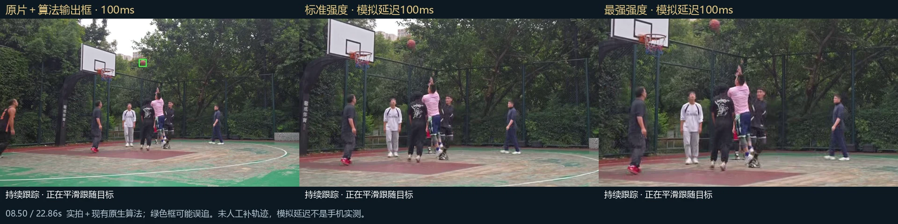

# 闹钟刺客记分牌 · Android

篮球记分、比赛计时、2V2 联赛与比分同步录像。面向篮球群的线下赛事，让群友组队、挑战、争冠，为每次约球增添乐趣。

## 下载 Android 安装包

**[⬇ 点击下载 APK · v3.4.16](https://github.com/gongzixiao001/basketball-app/releases/download/v3.4.16/CourtSideScoreboard-v3.4.16-debug.apk)**

Android 8.0 及以上 · 免费 · 9.87 MiB · 发布日期：2026-11-04

[官方网站](https://gongzixiao001.github.io/basketball-app/) · [版本说明与全部安装包](https://github.com/gongzixiao001/basketball-app/releases)

**使用演示：[YouTube](https://youtu.be/3w5EziovpIo) · [B 站](https://www.bilibili.com/video/BV1qdJ96AE9z/)**

如果没有自动下载，请进入上方版本页面，在 **Assets** 中点击 **CourtSideScoreboard-v3.4.16-debug.apk**。`Source code (zip)` 和 `Source code (tar.gz)` 是网站源码，不是 Android 安装包。

## v3.4.16 更新

- 内置摄像合成成功后只将带比分影片存入相册；失败保留私有临时原片以便重试。
- 完整积分榜 JPG 导出；倒计时 6 至 1 秒每秒一声、归零三声。
- 保留近期更新：录像与进攻计时联动、放大续录按钮、停止确认，以及竖屏加宽比分条和清晰头像。
- 调整录制时间基准和音轨封装并增加故障报告。**声音提前问题仍需真机复测，不能视为已确认修复。**

[详细版本说明](https://github.com/gongzixiao001/basketball-app/releases/tag/v3.4.16)

## 怎么安装

1. 在安卓手机上点击上方 APK 下载链接。
2. 下载完成后打开安装包，根据系统提示允许当前浏览器或文件管理器安装应用。
3. 首次打开选择简体中文、繁體中文、English 或日本語，确认后进入 APP。

**更新旧版本：直接覆盖安装，不要先卸载。建议先在 APP 中导出赛事备份。**

## 2V2 群赛事：为篮球群，打出自己的联赛

**为篮球群的线下赛事准备，让群友的每次约球，多一份联赛的乐趣。**

群友两人组队，从积分赛、以下克上挑战，一路打到冠军争夺。让熟悉的球友多一点较量、多一点话题，也多一个相约球场的理由。

积分落后，也有以下克上的机会。这套联赛分三步：

1. **常规积分赛**：固定双人队友，胜 +2、负 +1；赛果与积分排名同步更新。
2. **以下克上挑战**：锁榜后，每队有一次连续挑战机会，向当前排名前一名挑战。赢了继续向上，输了结束，最终席位留到挑战后确定。
3. **冠军 / 季军赛**：锁定最终排名后，前两名争冠；队伍足够时，第三、第四名争夺季军。

球队与球员档案、场次记录、本机自动保存及备份都已具备，完整对阵图与赛事路线图还可导出 JPG，方便在群里分享。让群主和组织者少操心，让群友把注意力留在球场。赛事数据保存在当前设备。

**[看看 2V2 联赛玩法与真实界面](https://gongzixiao001.github.io/basketball-app/#league)** · [下载安卓版，为群友办场联赛](https://github.com/gongzixiao001/basketball-app/releases/download/v3.4.16/CourtSideScoreboard-v3.4.16-debug.apk)

## 怎么用

- **快速记分**：选择半场或全场，设置双方队伍；使用加减分按钮记录比分，点球员头像记录犯规。
- **比赛计时**：按需要设置比赛时间；半场和 2V2 使用 12 秒进攻计时，全场使用 24 秒。
- **2V2 赛事**：新建或载入赛事，添加球队和球员，选择两队并确认进入比赛；在赛事中查看积分、对阵和记录。
- **比赛录像**：进入摄像，确认拍摄方向和麦克风，再开始录制。在录像界面操作比分，暂停或停止录制；保存的视频带比分信息。
- **球员管理**：在球员档案中添加、编辑或删除人员，后续组队可直接选用。

## 自动追踪实验项目：正在研究

已完成真实篮球素材的检测、短时跟踪和平滑数字构图回放验证，并制作手机导入视频／录像与检测并行的独立测试工具，继续优化模型执行速度与检测调度。**远处小球、遮挡和手机持续录像的实时表现仍待改善，未包含在正式版 v3.4.16 中。**

同帧 08.50 秒对比：左为原画与算法框，中为标准构图，右为最强构图。**原生算法离线回放，100ms 为模拟结果延迟，不是真机速度；非 AI 生成图。**

[查看完整实验进度、第二张限制示例与验证说明](docs/TRACKING_RESEARCH.md) · [官网图文展示](https://gongzixiao001.github.io/basketball-app/#research)

## 使用教程视频

观看基本操作演示，有疑问欢迎在视频下留言。

- **[YouTube：观看使用演示](https://youtu.be/3w5EziovpIo)**
- **[B 站：观看使用演示](https://www.bilibili.com/video/BV1qdJ96AE9z/)**
- [官网教程与播放器](https://gongzixiao001.github.io/basketball-app/#demo)

## 联系作者

作者：土鱼 · 邮箱：[alick.ceng@gmail.com](mailto:alick.ceng@gmail.com)

网站更新与发布方法见[维护说明](docs/MAINTENANCE.md)。
