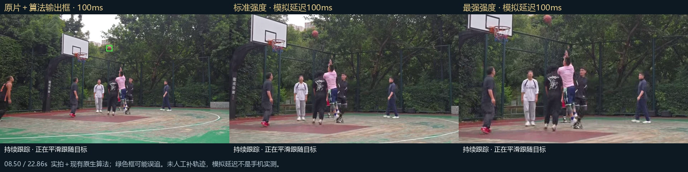
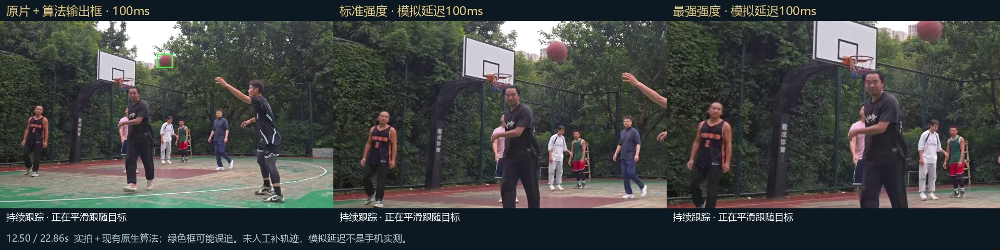

# 自动追踪实验项目 · 研发中

更新日期：2026-11-04。**正式版 v3.4.16 尚未包含自动追踪。原有摄像计分功能继续保留。**

目标是让手机在记录比赛时，自动检测篮球并进行平滑数字构图。现阶段是数字平移与裁切，没有完成云台物理转向控制，也没有自动计分。

## 目前做到哪一步

| 方向 | 当前进度 | 验证边界 |
| --- | --- | --- |
| 篮球检测与短时跟踪 | 已用多段真实球场素材回放测试 | 小球、遮挡、背景干扰仍会漏检或误跟 |
| 平滑数字构图 | 已完成标准／强／最强的回放演示 | 最强构图在部分飞行阶段仍可能裁到球；不改变物理镜头朝向 |
| 手机端能力验证 | 独立测试包支持导入视频，也支持录像与检测并行 | 未证明能稳定达到电脑离线回放效果；不承诺 50–80ms |
| 执行速度与调度 | 独立 test03 已加入执行配置测速、输入转换优化、局部／全景搜索调度与旧结果隔离 | 尚需同一素材、相同构图强度下复测；没有通过更换轻模型或降低输入尺寸来假装加速 |
| 正式 APP 集成 | 暂未发布 | 先改善手机实时可靠性，再考虑集成；无云台控制或自动计分承诺 |

“强”表示跟随构图强度，不是换成更强的检测模型。独立 test03 的跟随裁切仅用于预览，保存完整原片；不能宣称已支持追踪成片与比分合成。

## 真实对比截图

以下是 2026-10-26 对一段真实篮球素材运行现有 Android 原生算法后，得到的**离线回放**。同一时间点，左为原画与算法输出框，中为标准构图，右为最强构图。未人工补轨迹。100ms 是模拟结果送达延迟，不是真机测得的推理速度。图片不是 AI 生成图，也不是正式 APP 的实拍运行截图。

### 投篮飞行：08.50 秒

此处能跟到空中的篮球，展示数字构图随球位移动的效果。

### 当前限制：12.50 秒

检测框仍在球上，但最强构图已裁到球体上缘。识别成功不等于最终构图可靠，不能仅凭绿框数量判断效果。

这两张图用于说明进度与限制，不代表整段识别准确率，更不代表手机边录像边检测已经达到稳定水平。网站手机布局把三个原始面板上下排列，避免缩到看不清；完整图保留原测试的标题、时间与说明。

## 接下来验证

1. 相同视频比较导入分析与实拍录像并行负载，区分采集、输入准备、推理、排队与接续耗时。
2. 改善远处小球、遮挡后重新捕获和误跟；过期结果不能拖动镜头。
3. 检查最强构图的边缘余量、长时间录像温度与丢帧，再决定是否进入正式版。

素材及图片来源见 [tracking-image-sources.json](tracking-image-sources.json)。本页面只公开选定对比图与进度，不上传原始测试报告中的设备信息或本地路径。

[返回官网实验区域](https://gongzixiao001.github.io/basketball-app/#research)
